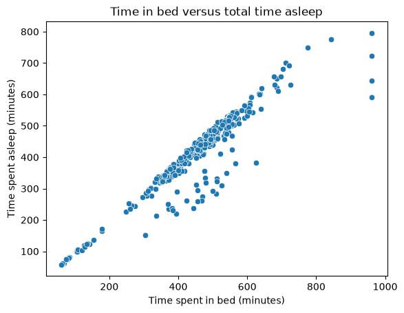
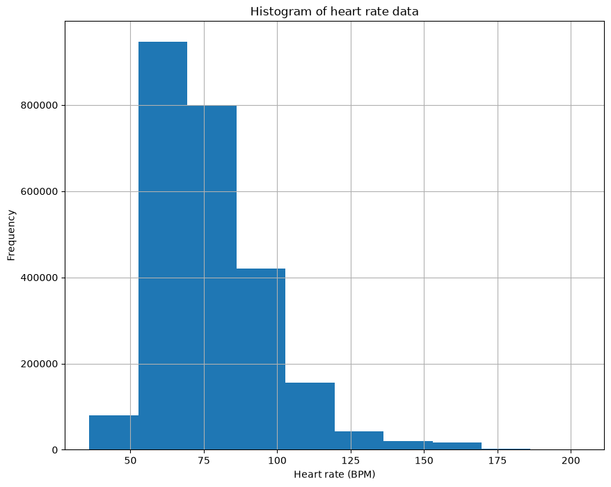

# DATA2007 - Fitbit Data Analysis Task: EDA
## Purpose and scope
This document summarises the exploratory data analysis (EDA) of 18 CSV files containing Fitbit fitness data (sleep, activity and caloric intake) for 33 users, collected March-May 2016. The EDA assesses how this data could underpin a health tracker app, by identifying which user behaviours and metrics can be reliably measured, what patterns exist and what data-quality issues could constrain the app's features.
## Dataset overview table

**Table 1**, below, provides a summary of the data captured in the 18 CSV files. 

**Table 1:** Summary of 18 Fitbit CSV files.
| Files | Rows | Cols | Key | Date range | unique IDs |  missing | duplicates | Notes |
| ----- | :--: | :--: | --- | ---------- | :--------: | :-------: | :----------: | ----- |
| dailyActivity_merged | 940 | 15 | Id and date (daily) | 12/04/2016 - 12/05/2016 | 33 | 0 | 0 | Useful steps, calories and activity intensity measures. |
| dailySteps_merged | 940 | 3 | Id and date (daily) | 12/04/2016 - 12/05/2016 | 33 | 0 | 0 | Duplicates the steps already in dailyActivity. |
| hourlySteps_merged | 22099 | 3 | ID and date (hourly) | 12/04/2016 - 12/05/2016 | 33 | 0 | 0 | Useful for time-of-day activity trends. |
| minuteStepsNarrow_merged | 1325580  | 3 | Id and date (minutely) | 12/04/2016 - 12/05/2016 | 33 | 0 | 0 | Detailed but not necessary for an initial dashboard. |
| minuteStepsWide_merged | 21645 | 62 | Id and date (hourly) | 13/04/2016 - 13/05/2016 | 33 | 0 | 0 | |
| dailyCalories_merged | 940 | 3 | Id and date (daily) | 12/04/2016 - 12/05/2016 | 33 | 0 | 0 |
| hourlyCalories_merged | 22099 | 3 | Id and date (hourly) | 12/04/2016 - 12/05/2016 | 33 | 0 | 0 |
| minuteCaloriesNarrow_merged | 1325580 | 3 | Id and date (minutely) | 12/04/2016 - 12/05/2016 | 33 | 0 | 0 |
| minuteCaloriesWide_merged | 21645 |  62 | Id and date (hourly) | 12/04/2016 - 12/05/2016 | 33 | 0 | 0 | Each row corresponds to the calroies burned per minute during the hour. |
| dailyIntensities_merged | 940 | 10 | Id and date (daily) | 12/04/2016 - 12/05/2016 | 33 | 0 | 0 | Intensities scale:  0 = sedentary, 1 = light, 2 = moderate and 3 = vigorous. |
| hourlyIntensities_merged | 22099 | 4 | Id and date (hourly) | 12/04/2016 - 12/05/2016 | 33 | 0 | 0 | Intensities scale:  0 = sedentary, 1 = light, 2 = moderate and 3 = vigorous. |
| minuteIntensitiesNarrow_merged | 1325580 | 3 | Id and date (minuetly) | 12/04/2016 - 12/05/2016 | 33 | 0 | 0 | Intensities scale:  0 = sedentary, 1 = light, 2 = moderate and 3 = vigorous. |
| minuteIntensitiesWide _merged| 21645 | 62 | Id and date (hourly)| 13/04/2016 - 13/05/2016 | 33 | 0 | 0 | Each row corresponds to the intensity level of the user per minute during the hour.   Intensities scale:  0 = sedentary, 1 = light, 2 = moderate and 3 = vigorous. |
| minuteMETsNarrow _merged| 1325580 | 3 | Id and date (minutely) | 12/04/2016 - 12/05/2016 | 33 | 0 | 0 | A measure of how high your activity rate is. Light: < 3.0 METs; Moderate: 3.0–6.0 METs; Vigorous: > 6.0 METs.   METs needs to be divided by 10 - all too large. |
| heartrate_seconds _merged| 2483658 | 3 | Id and date (every 5 seconds) | 12/04/2016 - 12/05/2016 | 14 | 0 | 0 | 19 users are missing. |
| weightLogInfo _merged| 67 | 8 | Id and date (secondly) | 12/04/2016 - 12/05/2016 | 8 | 65 | 0 | 65 fat measurements missing. |
| minuteSleep _merged| 188521 | 4 | Id and date (minutely) | 11/04/2016 - 12/05/2016 | 24 | 0 | 543 | 9 users missing, 543 duplicate rows found in data. |
| sleepDay _merged| 413 | 5 | Id date date (daily) | 12/04/2016 - 12/05/2016 | 24 | 0 | 3 | 9 users missing, 3 duplicate rows found in data. |

## Structure and relationships

All 18 files share a user identifier (Id) and a timestamp (captured at four different granularities: daily, hourly, per-minute and per-second). The user Id and timestamp could be used to join data across files. Data completeness across the data presents a minor challenge where four files (sleepDay, heartrate_seconds, minuteSleep and weightLogInfo) are know to be missing measurements from a significant number of users - this is illustrated below in **Figure 1**.  

**Figure 1:** Participant ID presence across Fitbit datasets

## Data quality

### Data completeness

As identified above, there are four CSV files where all 33 user Id's are not present. Moreover, in the instances where all user Id's are present, it has been found that there do not exist measurements for all users at all intervals - this is shown below in **Table 2**. There are also several instances of data duplication:
* Intensities and calories are tracked on a daily, hourly, minutely and secondly basis.
* Steps are tracked on an hourly and daily basis.
* Sleep is tracked on an daily and minutely basis.

**Table 2:** Data completeness by file - taking into consideration the maximum number of entries each user could submit per category. 
| File | Mean completeness (%) | Min completeness (%) |
| ---- | :-------------------: | :------------------: |
| minuteIntensitiesWide_merged | 90% | 9% |
| dailyActivity_merged | 92% | 13% |
| sleepDay_merged | 55% | 3% |
| heartrate_seconds_merged | 77% | 13% |
| minuteIntensitiesNarrow_merged | 91% | 12% |
| minuteMETsNarrow_merged | 91% | 12% |
| hourlySteps_merged | 91% | 12% |
| hourlyIntensities_merged | 91% | 12% |
| dailyCalories_merged | 92% | 13% |
| hourlyCalories_merged | 91% | 12% |
| minuteSleep_merged | 18% | 0% |
| minuteCaloriesNarrow_merged | 91% | 12% |
| dailySteps_merged | 92% | 13% |
| minuteCaloriesWide_merged | 90% | 9% |
| minuteStepsNarrow_merged | 91% | 12% |
| minuteStepsWide_merged | 90% | 9% |
| weightLogInfo_merged | 1% | 0% |
| dailyIntensities_merged | 92% | 13% |

In **Table 2** we see that in most files the average user has provided data for ~90% of the time intervals available. However, each file contains at least one user who has submitted data for ~10% of the time intervals. sleepDay_merged (55%), heartrate_seconds_merged (77%), minuteSleep_merged (18%) and weightLogInfo_merged (1%) have an average compltetion rate significantly below the others.

### Duplicates

SleepDay (3) and minuteSleep (543) both have duplicated entries which need to be removed. 

### Data formatting

Firstly, the name of each timestamp column is inconsistent and requires formatting specific to the timestamp allocated to that data. Secondly, the timestamp format can vary by file (daily, hourly, per minute and per second). Consequently, careful aggregation is required to enable the aggregation of data across different files - particuarly if different timestamp formats are present. Otherwise, the data type assigned to other value columns appears appropirate. 

## Initial findings
This section provides a brief overview of some findings that could be incorporated into the health tracker app.

### Sleep score 

**Figure 2** shows a strong relationship between time in bed and time asleep, but with notable variance, as some nights show far less sleep than time in bed. This could support a sleep-efficiency metric, particularly if the number of sleep records per night is incorporated to account for naps and broken sleep.

**Figure 2:** Time spent in bed versus time slept.

### Calories and steps

**Figure 3** shows calories burned rising with daily steps, but with wide variance at any given step count. Many users burn 1,500-2,500 calories on very few steps, so calories are driven by more than steps, and steps alone would be a poor calorie estimate for the app.

**Figure 3:** Steps per day versus calories burned per day.

### Resting heart rate
Most heart rate readings fall between 55 and 100 BPM, with a long tail of high readings during exercise, supporting personalised resting-rate baselines in the app.

**Figure 3:** Histogram of heart rates.

## Conclusion and next steps
The data contained within the Fitbit files is suitable for a variety of health tracker applications (such as sleep, calorie and activity tracking).

However, before data analysis the following steps are required:
* Dropping redundant files (e.g., keeping the most appropirate file in instances where a metric is tracked multiple times).
* Removal of duplicates.
* Parsing of timestamps.

The next step is to commence product ideation and the final product requirements. 

## AI disclaimer
Please note that Microsoft's Copilot LLM was used in the preperation of this document. Copilot was used for the following tasks:
* Providing a structure for this document.
* Providing advice on how to achieve conciceness, identify inconsistencies and for gramatical and spelling errors.
* Providing advice on markdown syntax (e.g., how to create a table, import images and assign heading levels).

Outputs from Copilot were then evaluated through a variety of approaches (e.g., using online guides for markdown advice and peer reviews from the team).